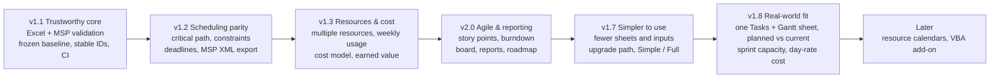

# Backlog

Prioritised from [MSP_GAP_ANALYSIS.md](MSP_GAP_ANALYSIS.md) and the original requirements. Each ID links to its GitHub issue; labels carry priority, size, epic and release.

**Priority:** P0 = needed before relying on it · P1 = core MS Project parity · P2 = valuable · P3 = nice to have
**Size:** S ≈ under a day · M ≈ 1–3 days · L ≈ a week or more
**Approach:** F = formulas in the workbook · Py = Python script in this repo (build and test only) · Web = browser page, no install · VBA = optional macro add-on

## What end users need

| Piece | Who needs it | What they need |
|---|---|---|
| `Project_Planner.xlsx` (formulas) | Everyone | Excel only (desktop, web, iPhone/iPad, Mac). No macros, no Python. |
| Build script and tests (Python) | Developers of this repo | Python + LibreOffice. GitHub Actions runs them, so users never do. |
| MS Project XML converter (B-701/B-702) | Anyone moving to/from MS Project | A web page that runs in the browser, phone included. Nothing to install. Python CLI version for automation. |
| Macro add-on `.xlsm` (B-704) | Optional, desktop Excel users who want buttons | Desktop Excel with macros enabled. Excel for web, iPhone and iPad can't run macros, so no feature may depend on it; each button only automates something the .xlsx can already do by hand. |

## Roadmap

| Release | Goal | Items |
|---|---|---|
| **v1.1 Trustworthy core** | Safe to use on a real project and hand to MS Project users | B-001, B-002, B-003, B-004, B-005, B-008, B-104, B-204, B-802 |
| **v1.2 Scheduling parity** | Behaves like MS Project's scheduler | B-101, B-103, B-105, B-501, B-503, B-701, B-703 |
| **v1.3 Resources & cost** | Real resource planning | B-203, B-301, B-302, B-303, B-304, B-401 |
| **v2.0 Agile & reporting** | Sprint planning and status reporting | B-402, B-403, B-404, B-505, B-601, B-602 |
| **v1.7 Simpler to use** | A first plan in minutes; a weekly update on three sheets ([review](SIMPLIFICATION_REVIEW.md)) | B-901 – B-918 (E9) |
| **v1.8 Real-world fit** | What a PM using it in Excel asked for: one plan sheet, visible slip, real sprint capacity and cost ([design](REAL_WORLD_FIT.md)) | B-1001 – B-1020 (E10), then B-913 / B-914 |
| **Release 1.0 (final freeze)** | A first-time PM can't break it and reports in 10 minutes: a separate workbook in `release-1.0/` | R1-01 – R1-16 ✅ DONE; the rest is v1.1 Future |
| **Later** | | everything else |

## Next up (v1.8)

From the owner's review of v1.7 in Excel; the designs agreed for it are in [REAL_WORLD_FIT.md](REAL_WORLD_FIT.md).

1. ✅ **B-1001** – Automatic calculation in every shipped file (the likely cause of "Gantt doesn't update").
2. ✅ **B-1002** – Planned vs current on the Gantt: planned = border, current = fill; the sample ships with a baseline and slip.
3. ✅ **B-1003 / B-1004** – Editable sprint dates; day-rate costing with Allocation %.
4. ✅ **B-1005** – One Tasks + Gantt sheet.
5. ✅ **B-1006 / B-1007** – Sprint capacity per person (allocation, leave, dates, 80/20 focus) and the Agile sheet's per-sprint task list.
6. ✅ **B-1008 / B-1009** – Schedule Report folded into Status; Roadmap reworked around the phases.
7. ✅ Then B-913 (Simple / Full, redone on the new sheet set) and B-914 (start from a list).

## Release 1.0: final freeze ✅ DONE

The owner's brief: *no new scheduling engine work, no new reports; only make it so a first-time PM cannot break it
and can deliver a status report in 10 minutes.* It is a **separate workbook**, built with `--release` into
`release-1.0/` (`Project_Planner.xlsx`, `_Blank`, `_Simple`); the classic v1.8 workbooks at the repository root
don't change. Template version **1.0** (the `TemplateVersion` name, shown on Start and every printed footer); the
code's `PlannerVersion` is 2.0, which the upgrade reads. The checks before release are in
[RELEASE_CHECKLIST.md](RELEASE_CHECKLIST.md).

Decisions taken with the owner before coding (the brief asked for some things the rules or Excel rule out):

| Asked | Done instead | Why |
|---|---|---|
| LET, LAMBDA, XLOOKUP, FILTER, SEQUENCE; `L_PARSE_DURATION` and friends in Name Manager | Excel 2019 functions; `TEXTJOIN` (Excel 2019) for the pickers and leave grid; a `_Days` column is the duration parser; Check uses ranked lists | Excel 2019 is the stated minimum (a test enforces it), and the CI recalculates in LibreOffice, which has no LAMBDA. An M365 edition is v1.1 |
| No OFFSET | OFFSET stays in the 2,200 scheduling helper cells only (allow-listed); nothing new uses it | The only insert-safe, non-circular way to read another row's calculated date (docs/ARCHITECTURE.md) |
| `UID = MAX(Tasks[UID])+1` as a formula | UIDs stay pre-filled; a typed UID must be new (validation); Settings and Check count duplicates and missing ones | A formula UID is circular and renumbers when rows move, which would break every link |
| Protect Tasks with Allow Edit Ranges | Tasks, Resources, Settings and History ship unprotected with their blue inputs unlocked (Review > Protect Sheet locks only formulas); every other sheet ships protected | Excel can't add table rows on a protected sheet; Allow Edit Ranges doesn't work on the web or iPhone |
| Fewer than 15 conditional-formatting rules | 114 rules (121 in v1.8); no rule per row; the summary grey-out is one rule | The Gantt alone needs about 15 rules |
| Phase 3 (RACI, Sandbox, PERT, narrative, burndown, capacity chart) | v1.1 below | The freeze: no new reports |

### P0 (Release 1.0): all done

| ID | Item | Problem | Before | Fix | Excel | Acceptance | Perf |
|---|---|---|---|---|---|---|---|
| R1-01 | ✅ UID safety | A typed duplicate UID sends links to the wrong task | Issues flags it after the fact | Validation refuses a duplicate or non-whole UID; Settings > DuplicateUIDs / MissingUIDs; Check lists them; Next free UID at the top of Tasks | Custom rule `AND(ISNUMBER(x),x>=1,x=INT(x),COUNTIF(tsk_UID,x)=1)` | `test_release.StructureTest.test_validation`, `EditTest.test_uids_and_check` | 2 cells |
| R1-02 | ✅ Predecessor and resource pickers | Typing `12, 14SS+2d` is the biggest source of errors for a new PM | One text cell each | Pred1-4 (dropdown of the detail tasks, "UID Name"), Type1-4, Lag1-4; Res1-4 (dropdown of Resources), Units1-4. Pred1 / Type1 / Lag1 and Res1 / Units1 shown, the rest behind +. The typed text still works while the pickers are blank (imports and pastes land there); Issues says when it is ignored | `_Predecessors` / `_Resources` = TEXTJOIN of the pickers, else the text; the scheduler reads them unchanged. `_PickList` (SMALL over `_PickKey`) feeds the dropdown | `EditTest.test_pickers`, `CommittedSampleTest.test_same_plan_as_the_classic_sample` (the sample's links come from the pickers and schedule identically) | +1,000 formulas (5 per task) |
| R1-03 | ✅ Leave by day | `16, 17(0.5)` in a month cell is hard to get right | Month text cells | LEAVE BY DAY grid under the people: person, month (dropdowns), days 1-31 (1 or 0.5); its Days column builds the text; every leave look-up adds it to the month cell | TEXTJOIN of 31 cells; one MATCH per leave look-up on the person and month | `CommittedSampleTest.test_same_capacity_with_leave_on_the_day_grid` (two people's leave on the grid gives the same capacity), `ToolsTest` (upgrade carries it) | +80 formulas; grids unchanged |
| R1-04 | ✅ Duration as 3, 3d or 2w | "2d" pasted counted as 0 | A number only | `_Days` reads 3, 3d, 2w (5 days a week); validation refuses "2days"; Issues explains a pasted one | Custom validation; `_Days` with VALUE / LEFT / RIGHT | `EditTest.test_duration`, `StructureTest.test_duration_rule_accepts_and_refuses` | +200 formulas |
| R1-05 | ✅ Date checks | A date before the project start, or text | Any date | Actual / constraint / deadline dates must be on or after ProjectStart | Date validation `>= ProjectStart` | `StructureTest.test_validation` | none |
| R1-06 | ✅ Sheet set-up | | | Frozen panes and filters on every input table (as v1.8), a plain table style | | `StructureTest` | none |
| R1-07 | ✅ TakeBaseline | Re-baselining overwrote agreed baselines; new tasks had none | BL Source = current dates | Settings > TakeBaseline: No (default) = BL Source keeps each pasted baseline, current dates only for tasks without one; Yes = re-baseline everything. One Copy, one Paste Values | `IF(OR(TakeBaseline="Yes",N([@Baseline Start])=0),[@Start],[@Baseline Start])` (reads an input: not circular) | `EditTest.test_take_baseline*` | none |
| R1-08 | ✅ TakeSnapshot sheet (optional, not in Simple) | The weekly snapshot and the baseline were steps buried in the reference | SnapshotNow at the bottom of Status | Steps with links: the snapshot row (`snap_Row`), History, the BL Source and Baseline columns (`tsk_BLSource`, `tsk_Baseline`) | Hyperlinks to defined names | `StructureTest.test_snapshot_links`, `CommittedSampleTest.test_check_and_snapshot` | 15 formulas |
| R1-09 | ✅ Check sheet (optional, not in Simple) | No single place says "ready to report" | Issues per row, counts on Status | Counts per kind of problem, a verdict (All clear / n to fix), lists of tasks with Issues, over-allocated tasks, overdue Log items | Ranked tables (SMALL + MATCH over key columns), no FILTER | `CommittedSampleTest.test_check_and_snapshot`, `EditTest.test_uids_and_check` | 370 formulas |
| R1-10 | ✅ Protection | Formulas typed over by accident | Status, Roadmap, Resource Report | Also Start, Agile, Log, Cost, Check, TakeSnapshot protected (no password); input sheets ship with blue cells unlocked | `core.protect_view`; `release._unlock_inputs` | `StructureTest.test_protection` | none |
| R1-11 | ✅ Printing | Reports printed over several pages | Some fit-to-page | Status, Roadmap, Resource Report on one page, Check one page wide; header sheet and file name, footer "Project Planner template 1.0" and page n of m. Excel headers can't read cells, so the project name and status date print from each sheet's title rows | Page set-up | `StructureTest.test_printing` | none |
| R1-12 | ✅ TemplateVersion 1.0 | | PlannerVersion only | `TemplateVersion` = "1.0" on Start and in footers; the upgrade carries Pred1-4, Res1-4 and the leave grid by header (RACI, Sandbox, Opt / Pess will follow the same way in v1.1) | Defined name | `ToolsTest` | none |
| R1-13 | ✅ Simple has no references to missing sheets; a 12-task sample | | The 30-task sample | Release Simple: 12 tasks of the sample, linked among themselves, with its own baseline | | `ModulesTest`, `CommittedSampleTest.test_simple_sample` | |
| R1-14 | ✅ Start: five onboarding steps with links | | Five steps, some without a link | Project, People, Tasks (pickers), Check, Baseline: each links to its sheet | Hyperlinks | `StructureTest.test_start_has_five_linked_steps` | none |
| R1-15 | ✅ Docs | | | README (Release 1.0, Limits), ARCHITECTURE (named formulas, why no LAMBDA), TESTING_ON_IPHONE (Release 1.0 steps), this backlog, RELEASE_CHECKLIST | | | |
| R1-16 | ✅ Release checklist | | | [RELEASE_CHECKLIST.md](RELEASE_CHECKLIST.md), each item checked by `scripts/release_check.py` or a named test | | `python scripts/release_check.py` | |

### P1 / P2: v1.1

Template 1.1 is its own workbook too: `--release 1.1` builds `release-1.1/` (TemplateVersion 1.1, PlannerVersion
2.1) from the Release 1.0 code plus the items below, so `release-1.0/` stays frozen. With Settings > Sandbox = No the
1.1 sample schedules exactly as the 1.0 sample (`test_release_11.CommittedSampleTest`). Upgrade a 1.0 workbook with
`python scripts/upgrade_planner.py Old.xlsx New.xlsx --release 1.1`.

| ID | Item | Pri | Done as | Acceptance | Perf |
|---|---|---|---|---|---|
| F-1101 | ✅ RACI per task | P1 | Tasks > RACI (+): Accountable (dropdown of Resources), Consulted, Informed; Responsible = the task's Resources. Resources: Accountable For / Consulted On / Informed Of counts (exact names in comma lists) | `test_release_11.CommittedSampleTest.test_raci_counts` | +150 formulas (3 per person) |
| F-1102 | ✅ External dependencies, top 5 on Status | P1 | Log: Expected (input), Task Start, Gap (days: negative = arrives after the task should start), `_DepKey`; Status: EXTERNAL DEPENDENCIES, the five latest against their task; Check counts the late ones | `test_dependencies` | +600 formulas (Log, 150 rows x 4) |
| F-1103 | ✅ Sandbox what-if | P1 | Tasks: Sandbox Duration (3, 3d, 2w); Settings > Sandbox = Yes makes `_Days` use it, so the whole plan and every report show the what-if; Status (red banner), the summary and Check say so | `SandboxTest` | none (one IF in `_Days`) |
| F-1104 | ✅ Automatic status narrative | P1 | Status > SUMMARY (`sts_Narrative`): RAG, finish against plan, progress, late tasks, next milestone, top risk, late dependencies, sandbox | `test_narrative` | 1 cell |
| F-1105 | ✅ Three-point estimates with P50 / P80 | P1 | Tasks: Optimistic, Pessimistic, Expected = (O + 4 x Duration + P) / 6; Settings > PertP50 = forecast finish + the critical tasks' total shift, PertP80 = + 0.84 standard deviations (variances added); both on Status. Issues flags estimates that don't bracket the Duration | `test_pert` (recomputed in Python) | +800 formulas (Tasks, 4 per task) |
| F-1106 | ✅ Risk-exposure burndown in History | P2 | A snapshot field, Risk Exposure = the open RAID items' scores added up (`SUMIFS(log_Score,log_Open,1)`), on Status > SnapshotNow, TakeSnapshot and History, with a trend chart on History | `test_release_11.P2Test.test_risk_exposure` | 2 formulas |
| F-1107 | ✅ Capacity chart | P2 | Agile: available vs planned person-days per sprint (bar chart over SprintTable) | `test_capacity_chart` | none (a chart) |
| F-1109 | ✅ Fewer conditional-formatting rules (part) | P2 | 119 -> 106 in the 1.1 sample: `release.merge_rules` makes one rule of identical rules whose formula fixes every column and whose ranges start on the same row (the Log's type grey-outs), and the Log's status words share a rule per colour. The Gantt, RAG and variance rules use relative column references, which Excel reads against a range's top-left cell, so merging them could change their meaning; they stay | `test_merged_rules_mean_the_same` (every cell gets the same rules in the same order), `test_committed_rule_count` | fewer rules |

| F-1108 | ✅ Microsoft 365 edition | P2 | A separate edition, `--release m365` -> `release-1.1-m365/` (TemplateVersion "1.1 M365", PlannerVersion 2.1-m365), so 1.1 is never at risk: named LAMBDAs with LET (`L_PARSE_DURATION` for `_Days` and Sandbox, `L_WORKING_DAYS` for the Log's Gap and the finish variance, `L_IS_WORKING_DAY` for a new Issues check), the Check lists as FILTER array formulas (the three key columns go). The scheduling passes are unchanged. Saved without values (LibreOffice can't calculate it) | `tests/test_m365.py` (structure: the names as Excel stores them, the formulas call them, the 1.1 inputs, no missing names, the other editions unchanged); **values: by hand in Excel**, TESTING_IN_EXCEL.md section 8 | -900 formulas (47,890 vs 48,800) |

### v1.1 Future (not built yet)

| ID | Item | Pri | Notes |
|---|---|---|---|
| F-1110 | Microsoft 365 edition: spilled lists and a searchable pick list | P3 | Real spilled arrays (Excel's dynamic-array metadata, which openpyxl can't write) instead of fixed-size array formulas; a Pred dropdown filtered to the tasks above the row; CI recalculation once LibreOffice (24.8+) or another engine can evaluate LAMBDA |

## Template 1.2: design, UX and the rest of the backlog

Built with `--release 1.2` into `release-1.2/` (TemplateVersion 1.2, PlannerVersion 2.2) from the 1.1 code; 1.0, 1.1
and the Microsoft 365 edition don't change. Everything new is behind `core.v12()`. Delivered in four PRs: design and
UX, the UX backlog items, the engine items, the add-ons (and the Microsoft 365 edition's F-1110).

| ID | Item | Pri | Done as | Acceptance | Perf |
|---|---|---|---|---|---|
| D-1201 | ✅ Fluent design | P1 | `planner/theme.py`: one final pass remaps every colour and font to a Fluent palette (brand blue #0F6CBD inputs, dark brand #0F548C input headers, neutral #424242 formula headers, #F5F5F5 formula cells, Fluent red / amber / green with AA-contrast text), Segoe UI, banded tables, tab colours by role (plan blue, reports teal, logs orange, settings grey), no gridlines and 100% zoom on report pages, the Start sheet as a landing page (large title, tinted step rows, prints one page wide). Meanings unchanged: blue = type, grey = calculated | `test_release_12.DesignTest` (no classic colour or font left; inputs still unlocked) | none (styles only) |
| B-206 | ✅ MS Project status names | P2 | Tasks > DETAIL: MSP Status = Complete, Future Task (starts after the status date), Late (behind the progress planned by now, or a later finish than planned) or On Schedule; the richer Status stays | `test_release_12.UXTest.test_msp_status` | +200 formulas |
| B-404 | ✅ Board view | P2 | Board sheet (optional, not in Simple): five status columns of cards (task and people), filtered by a Sprint and a Person dropdown; one key column on Tasks (`_BoardKey` = status x 100000 + row) and a MATCH per card | `test_board`, `BoardFilterTest` | +200 Tasks, +250 Board |
| B-405 | ✅ Product backlog sheet | P2 | Backlog sheet (optional): items with MoSCoW priority, points, owner, status, notes; "On Tasks" = Yes once a task of the same name exists; points by priority and ready to plan | `test_backlog` | +105 |
| B-010 | ✅ Locale-safe labels | P2 | `planner/locale_safe.py` rewrites every `TEXT(date, "...")` into DAY / YEAR and month / weekday names from constant strings (Gantt headers, titles, the summary), so they read the same in every Excel language; cell number formats were already safe | `test_locale_safe_dates` | none |
| B-508 | ✅ Print layouts | P2 | Tasks (with its Gantt) prints on A3 landscape at 60% with the title rows and ID-Task columns repeated on every page | `test_summary_line_and_printing` | none |
| B-509 | ✅ Custom fields | P2 | Tasks > CUSTOM FIELDS: Text 1-5, Number 1-5, Flag 1-3 (inputs, no formulas); the MS Project XML export maps them to Text2-6, Number2-6 and Flag1-3 (Text1 / Number1 carry Sprint and points), with the column name as the alias | `test_custom_fields_go_to_ms_project` | none |
| B-111 | ✅ Project summary line (part) | P3 | A line above the Tasks table: dates, tasks, % done, critical tasks, next free UID. The "Milestone" flag for tasks with a duration stays in the backlog (it changes the Gantt and the export) | `test_summary_line_and_printing` | 1 cell |
| B-506 | ✅ Network diagram | P3 | `scripts/network_diagram.py`: Mermaid (phases as subgraphs, milestones round, critical tasks red, SS / FF / lags on the arrows) or Graphviz DOT | `test_exports` | none |
| B-706 | ✅ CSV export for Jira / Azure DevOps / Planner | P3 | `scripts/export_csv.py --format jira / azure / planner`: each tool's import columns (Jira keeps the hierarchy with Issue Id / Parent Id; Azure DevOps types Epic / Feature / Task; Planner buckets = phases) | `test_exports` | none |
| B-803 | ✅ Versioning and releases | P2 | CHANGELOG.md; the version is on Start and in printed footers (TemplateVersion) | review | none |
| B-804 | ✅ More sample projects | P3 | `--sample construction` (a clinic extension, Construction stages) and `--sample event` (a partner summit with a fixed date), in `release-1.2/samples/` | `test_more_samples` | none |
| D-1202 | ✅ Pred dropdown lists only the tasks above | P2 | The Pred1-4 validation list is `OFFSET` over the pick list, as long as the number of detail tasks above the row (`COUNTIF` of `_IsLeaf` from the header down): the only tasks a link may use. Validation is evaluated when the dropdown opens, so it adds nothing to recalculation | `test_pick_list_shows_only_tasks_above` | none |
| B-102 | ✅ Lag in % and elapsed days | P3 | `12FS+50%` = half the predecessor's duration (whole working days); `12+3ed` = 3 calendar days, then the first working day on or after (spec section 2). Typed or in the Lag pickers (text cells); the MS Project export writes elapsed lags as LagFormat 8 | `test_release_12.EngineTest` against `reference_schedule.py` (v12) | +4 helper columns (`_Pred{k}Elapsed`) |
| B-110 | ✅ Inactive tasks (part) | P3 | Tasks > SCHEDULING: Active = No leaves the task out of the schedule, roll-ups, work and cost; links to it are ignored with a reason; Status says Inactive; struck through; exported as `<Active>0</Active>`. Split tasks stay in the backlog (they need Gantt segments) | `EngineTest.test_inactive` | none (changes `_IsLeaf`) |
| B-202 | ✅ Remaining duration, actual work, % work complete | P2 | Tasks > ACTUALS: Remaining Duration on a started task sets its finish (from the status date) and progress; Actual Work sets work done and actual cost; % Work Done = actual work / work; Issues explains a value it can't use | `EngineTest.test_remaining_duration_and_actual_work` | +2 columns |
| B-201 | ✅ Baselines 2 and 3 | P2 | Tasks > BASELINE: Baseline 2 / 3 Start and Finish; Settings > CompareBaseline (1-3) picks the one Planned Start / Finish, the variances and the Gantt use; TakeSnapshot links copy the current baseline's dates into 2 or 3 | `EngineTest.test_baseline_2`, `CompareBaselineTest` | none (inputs; PS / PF use a CHOOSE) |
| B-302 | ✅ Cost per use and fixed costs (part) | P2 | Cost sheet: RateCard Per Use (once per task a person is on, accrued at the start) and a FixedCosts table (UID, amount, description; accrued with progress), in each task's cost, budget and actual cost. Overtime and material / cost resources stay in the backlog | `EngineTest.test_costs` | +2 helper columns on TaskCost (`SUMIFS`) |

## Done in v1.7 (was "Next up after v1.6")

Most of the original top 10 is done. The planner now does nearly everything; the next step is to make it ask for less.
See [SIMPLIFICATION_REVIEW.md](SIMPLIFICATION_REVIEW.md) for the findings behind E9.

1. **B-001 / B-002** – Finish validating in real Excel (opened, works at a high level) and MS Project (XML round trip).
2. **B-901** – Upgrade path first: every later E9 item moves or renames inputs.
3. **B-903 / B-904** – Collapse Tasks to its essential columns and one Issues column: the biggest win for the least change.
4. **B-902** – Start sheet: quick start plus the six settings a plan needs.
5. **B-905 / B-906** – Predecessors and Resources as one text cell each, as in MS Project.
6. **B-907 / B-909** – One row per person (Resources + Leave); Holidays and Lists into Settings.
7. **B-908** – Drop MSP_Tasks / MSP_Resources from the default build.
8. **B-910 / B-911** – One Status page (weekly hub) and one Log.
9. ✅ **B-913** – Modules and two downloads: Simple and Full.
10. **B-916** – Progress by Stage: standard steps with fixed % instead of a free % Complete; actual dates kept.
11. ✅ **B-914** – Start from a list: paste an outline or CSV into the converter page, get a workbook.

## Original top 10 (v1.1 – v1.6, mostly done)

1. **B-001 / B-002** – Prove it in real Excel and MS Project before adding features.
2. **B-003** – Frozen baseline. Without it, "planned vs actual" can silently drift.
3. **B-004** – Stable Unique IDs so inserting a task doesn't break links.
4. **B-105** – Critical path and slack: the most-used MS Project analysis that is missing.
5. **B-701** – Microsoft Project XML export: the real path to "fully compatible".
6. **B-301** – Multiple resources per task.
7. **B-304** – Weekly resource usage counting working days only.
8. **B-203** – Earned value (SPI / CPI), since cost data already exists.
9. **B-403** – Sprint burndown / burnup.
10. **B-501** – Expand / collapse outline.

---

## E0 – Validation and hardening

| ID | Item | Pri | Size | How | Acceptance criteria |
|---|---|---|---|---|---|
| [B-001](https://github.com/LoneWolfDen/excel-project-planner/issues/1) | Validate in desktop Excel (Windows and Mac) and Excel for the web | P0 | S | – | Opens with no repair prompt and no circular-reference warning; dates match the LibreOffice test results; `WORKDAY.INTL` shows no `#NAME?`. Results recorded in `docs/compatibility.md`. |
| [B-002](https://github.com/LoneWolfDen/excel-project-planner/issues/2) | Round-trip test with MS Project | P0 | M | – | Sample project imported via the Import Wizard; IDs, outline, durations, links, resources, actuals and baseline match; differences documented with the import map used. |
| [B-003](https://github.com/LoneWolfDen/excel-project-planner/issues/3) | Frozen baseline | P0 | M | F + VBA later | New input columns Baseline Start / Finish / Duration / Work / Cost. "Set baseline" = documented copy → paste values (one-click in B-704). Variance and status measured against the baseline when present, falling back to the calculated plan. Rename columns to MS Project terms: Baseline, Start/Finish (current schedule), Actual. |
| [B-004](https://github.com/LoneWolfDen/excel-project-planner/issues/4) | Stable Unique ID (UID) for links | P0 | M | F | UID column with prefilled constants; predecessors reference UID; inserting or deleting rows keeps links correct; MSP export uses UID. Test inserts a row and checks dates. |
| [B-005](https://github.com/LoneWolfDen/excel-project-planner/issues/5) | Invalid-link detection | P1 | S | F | Linking to self, own summary or a summary task shows "Invalid link" in a check column and is ignored by scheduling, instead of causing a circular reference. |
| [B-006](https://github.com/LoneWolfDen/excel-project-planner/issues/6) | ✅ Excel Tables with structured references | P1 | L | F | Tasks, Resources, Sprints become Excel Tables; formulas read `[@Duration]`; new rows inherit formulas automatically. Spike first: confirm LibreOffice can still recalculate for tests. |
| [B-007](https://github.com/LoneWolfDen/excel-project-planner/issues/7) | ✅ Performance at scale (checked on every PR) | P1 | M | F | Generate 2,000 tasks; edit-to-recalc under 1 s in Excel; replace volatile OFFSET where it doesn't create circularity. |
| [B-008](https://github.com/LoneWolfDen/excel-project-planner/issues/8) | CI on GitHub Actions | P1 | S | Py | Workflow installs LibreOffice, builds the workbook, runs the tests, uploads the .xlsx as an artifact on every push. |
| [B-009](https://github.com/LoneWolfDen/excel-project-planner/issues/9) | ✅ Configurable row capacity (`--tasks`, `--resources`, `--grid-resources`, `--sprints`, `--gantt-columns`, `--weeks`) | P2 | S | Py | Build script options `--tasks`, `--resources`, `--sprints`, `--gantt-columns`. |
| [B-010](https://github.com/LoneWolfDen/excel-project-planner/issues/10) | Locale-safe labels and date formats | P2 | S | F | Weekday and month labels don't depend on the Excel language; date format is a setting. |

## E1 – Scheduling engine

| ID | Item | Pri | Size | How | Acceptance criteria |
|---|---|---|---|---|---|
| [B-101](https://github.com/LoneWolfDen/excel-project-planner/issues/11) | ✅ More predecessors per task | P1 | M | F | v1.5: four inline predecessor slots (`LINKS` in `planner/tasks.py`); MSP-format predecessor text, export and import include all. A Links sheet for unlimited links is not built. |
| [B-102](https://github.com/LoneWolfDen/excel-project-planner/issues/12) | Lag in % of predecessor duration and elapsed days | P3 | S | F | Lag accepts `50%` and `3ed`. |
| [B-103](https://github.com/LoneWolfDen/excel-project-planner/issues/13) | ✅ All MS Project constraint types | P1 | M | F | v1.5: Constraint dropdown (ASAP, ALAP, SNET, SNLT, FNET, FNLT, MSO, MFO) + Constraint Date; a conflict with a link shows as negative slack; exported to and imported from MSP. ALAP uses free slack. |
| [B-104](https://github.com/LoneWolfDen/excel-project-planner/issues/14) | Deadlines | P1 | S | F | Deadline column; flag and Gantt marker when forecast finish > deadline; exported to MSP Deadline field. |
| [B-105](https://github.com/LoneWolfDen/excel-project-planner/issues/15) | ✅ Critical path and slack (backward pass) | P1 | L | F | Late Start, Late Finish, Total Slack, Free Slack, Critical flag; critical bars red on Gantt. Successors must be below predecessors (flagged otherwise) to avoid circular formulas. Tests against a hand-calculated network. |
| [B-106](https://github.com/LoneWolfDen/excel-project-planner/issues/16) | Task types and effort-driven scheduling | P2 | M | F | Task Type (Fixed Duration / Fixed Work / Fixed Units); entering Work derives Duration from units. |
| [B-107](https://github.com/LoneWolfDen/excel-project-planner/issues/17) | Duration units | P3 | M | F | Duration in hours, days, weeks, months; elapsed durations; estimated flag (`?`). |
| [B-108](https://github.com/LoneWolfDen/excel-project-planner/issues/18) | Resource and task calendars | P2 | L | F | Per-resource working week and leave dates; task scheduled on its resource's calendar. Depends on B-303. |
| [B-109](https://github.com/LoneWolfDen/excel-project-planner/issues/19) | Recurring tasks | P3 | M | Py/VBA | Generate a summary with N occurrences (e.g. weekly status meeting). |
| [B-110](https://github.com/LoneWolfDen/excel-project-planner/issues/20) | Inactive and split tasks | P3 | M | F | Active flag excludes a task from schedule and roll-ups; split represented as two segments on the Gantt. |
| [B-111](https://github.com/LoneWolfDen/excel-project-planner/issues/21) | Project summary row and milestone flag | P3 | S | F | Row 0 rolls up the whole project; "Milestone" flag for non-zero-duration tasks. |
| [B-112](https://github.com/LoneWolfDen/excel-project-planner/issues/22) | Resource levelling | P3 | L | Py | Script delays lowest-priority tasks to remove over-allocation and writes a levelling delay column. |

## E2 – Tracking and progress

| ID | Item | Pri | Size | How | Acceptance criteria |
|---|---|---|---|---|---|
| [B-201](https://github.com/LoneWolfDen/excel-project-planner/issues/23) | Multiple baselines and interim plans | P2 | M | F + VBA | Baseline 1–3 columns, selectable "compare against" baseline in Settings. Depends on B-003. |
| [B-202](https://github.com/LoneWolfDen/excel-project-planner/issues/24) | Actual / remaining duration, actual work, % work complete | P2 | M | F | Entering actual work or remaining duration drives % complete and forecast, like MS Project. |
| [B-203](https://github.com/LoneWolfDen/excel-project-planner/issues/25) | ✅ Earned value | P1 | M | F | Actual Cost input; PV, EV, AC, SV, CV, SPI, CPI, EAC, VAC per task and project; dashboard tiles with RAG. Depends on B-003. |
| [B-204](https://github.com/LoneWolfDen/excel-project-planner/issues/26) | Full variance set | P1 | S | F | Start, finish, duration, work and cost variance against baseline. |
| [B-205](https://github.com/LoneWolfDen/excel-project-planner/issues/27) | Progress line on Gantt | P3 | M | F | Marker per task showing where progress is vs status date. |
| [B-206](https://github.com/LoneWolfDen/excel-project-planner/issues/28) | MS Project status names | P2 | S | F | Status matches MS Project's Status field (Complete, On Schedule, Late, Future Task) plus the current richer statuses. |
| [B-207](https://github.com/LoneWolfDen/excel-project-planner/issues/29) | ✅ Status snapshot history (copy / paste values; no macro needed) | P2 | M | VBA/Py | "Record snapshot" stores date, forecast finish, % complete, cost to a History sheet for trend charts. |

## E3 – Resources and cost

| ID | Item | Pri | Size | How | Acceptance criteria |
|---|---|---|---|---|---|
| [B-301](https://github.com/LoneWolfDen/excel-project-planner/issues/30) | ✅ Multiple resources per task (assignments) | P1 | L | F | v1.5: Assignments sheet (Task UID, Resource, Units) for the people beyond Tasks > Resource; work and cost per assignment; Tasks shows `A[50%], B` in Resource Names; resource totals, weekly and sprint load and over-allocation include them; MSP export and import carry all. |
| [B-302](https://github.com/LoneWolfDen/excel-project-planner/issues/31) | Cost model | P2 | M | F | Overtime rate, cost per use, fixed cost per task; Material = quantity × rate (no hours); Cost resources take an amount. |
| [B-303](https://github.com/LoneWolfDen/excel-project-planner/issues/32) | 🟡 Resource availability and leave | P2 | M | F | v1.4: leave by month (`16, 17(0.5)`) lowers capacity. Left: part-time max units by date range. Leave moves onto Resources in B-907. |
| [B-304](https://github.com/LoneWolfDen/excel-project-planner/issues/33) | ✅ Weekly resource usage | P1 | M | F | Resource × week grid of hours counting working days only, over-allocation in red, resource histogram chart. |
| [B-305](https://github.com/LoneWolfDen/excel-project-planner/issues/34) | ✅ Over-allocation flag on tasks (after leave) | P2 | S | F | Task row flags when its resource is over-allocated in any week of the task. |
| [B-306](https://github.com/LoneWolfDen/excel-project-planner/issues/35) | Role-based (generic) resources | P3 | S | F | Plan by role, then swap in named people; capacity by role. |

## E4 – Agile and sprint planning

| ID | Item | Pri | Size | How | Acceptance criteria |
|---|---|---|---|---|---|
| [B-401](https://github.com/LoneWolfDen/excel-project-planner/issues/36) | ✅ Manual sprint assignment and story points | P1 | S | F | Sprint override column (dropdown) wins over the automatic sprint; Story Points column; sprint capacity in points. |
| [B-402](https://github.com/LoneWolfDen/excel-project-planner/issues/37) | ✅ Velocity | P2 | S | F | Completed points per sprint, rolling average, forecast sprints remaining. |
| [B-403](https://github.com/LoneWolfDen/excel-project-planner/issues/38) | ✅ Burndown and burn-up (burn-up from History snapshots) | P1 | M | F | Daily remaining work/points for the active sprint and the release; ideal line; charts on Sprints and Dashboard. |
| [B-404](https://github.com/LoneWolfDen/excel-project-planner/issues/39) | Board view | P2 | M | F | Formula-generated board: columns Not Started / In Progress / Behind / Complete, filterable by sprint and resource. |
| [B-405](https://github.com/LoneWolfDen/excel-project-planner/issues/40) | Product backlog sheet | P2 | M | F | Unscheduled items with priority and points; promoted to Tasks with a sprint. |
| [B-406](https://github.com/LoneWolfDen/excel-project-planner/issues/41) | Flexible sprint calendar | P2 | S | F | Option to type sprint dates and names instead of generating them. |
| [B-407](https://github.com/LoneWolfDen/excel-project-planner/issues/42) | ✅ Sprint field in MS Project export | P2 | S | F | Sprint and story points exported to MS Project custom fields (e.g. Text1, Number1); documented. |

## E5 – Views and usability

| ID | Item | Pri | Size | How | Acceptance criteria |
|---|---|---|---|---|---|
| [B-501](https://github.com/LoneWolfDen/excel-project-planner/issues/43) | ✅ Expand / collapse outline | P1 | S | Py + F | v1.6: rows grouped by outline level on Tasks and Gantt; "Show to level N" setting (OutlineShowLevel) through the Show filter column. |
| [B-502](https://github.com/LoneWolfDen/excel-project-planner/issues/44) | Indented names on Tasks | P2 | S | F | Display column with indentation, or conditional number format, verified in Excel. Part of B-903's default view. |
| [B-503](https://github.com/LoneWolfDen/excel-project-planner/issues/45) | ✅ Gantt enhancements | P1 | M | F | v1.6: critical and deadline formatting; month / quarter scales. Not built: a label after each bar and colours from a Settings table: both need a formula in every timeline cell (conditional formatting can't show per-row text or read a colour), which the performance rule rules out; the resource is in the panel's Resource column. |
| [B-504](https://github.com/LoneWolfDen/excel-project-planner/issues/46) | Calendar view | P3 | M | F | Month grid listing tasks active each day. |
| [B-505](https://github.com/LoneWolfDen/excel-project-planner/issues/47) | ✅ Roadmap / timeline view | P1 | M | F | v1.6: Roadmap sheet, one landscape page of phases and milestones by month. |
| [B-506](https://github.com/LoneWolfDen/excel-project-planner/issues/48) | Network diagram | P3 | M | Py | Script exports links to Mermaid / Graphviz image. |
| [B-507](https://github.com/LoneWolfDen/excel-project-planner/issues/49) | Saved views and filters | P2 | S | F | Helper columns + slicers (with B-006) for Late, This week, Milestones, By resource. |
| [B-508](https://github.com/LoneWolfDen/excel-project-planner/issues/50) | Print layouts | P2 | S | Py | Gantt and Tasks print on A3 landscape with repeated headers. |
| [B-509](https://github.com/LoneWolfDen/excel-project-planner/issues/51) | Custom fields | P2 | S | F | Text1–5, Number1–5, Flag1–3 columns mapped to MS Project fields on export. |

## E6 – Reports

| ID | Item | Pri | Size | How | Acceptance criteria |
|---|---|---|---|---|---|
| [B-601](https://github.com/LoneWolfDen/excel-project-planner/issues/52) | ✅ Standard reports | P1 | M | F | Late tasks, Next 2 weeks, Milestone report, Cost overview, Resource overview. |
| [B-602](https://github.com/LoneWolfDen/excel-project-planner/issues/53) | ✅ RAG status | P1 | S | F | Project and phase RAG from schedule and cost variance with thresholds in Settings. |
| [B-603](https://github.com/LoneWolfDen/excel-project-planner/issues/54) | ✅ Trend charts | P2 | S | F | Forecast finish and cost trend from snapshots. Depends on B-207. |
| [B-604](https://github.com/LoneWolfDen/excel-project-planner/issues/55) | ✅ One-page status report | P2 | M | F | Printable summary: RAG, milestones, top risks/issues, next steps. |
| [B-605](https://github.com/LoneWolfDen/excel-project-planner/issues/56) | ✅ RAID log | P2 | M | F | Risks, Assumptions, Issues, Dependencies sheet with owner, due date, linked task UID. |

## E7 – Interoperability and automation

| ID | Item | Pri | Size | How | Acceptance criteria |
|---|---|---|---|---|---|
| [B-701](https://github.com/LoneWolfDen/excel-project-planner/issues/57) | ✅ Export to Microsoft Project XML (MSPDI) | P1 | L | Web + Py | `planner export-xml file.xlsx out.xml` writes tasks, outline, links by UID, calendar and holidays, constraints, baselines, resources, assignments; MS Project opens it with matching dates. Delivered as a browser page (drop the .xlsx, download the .xml; works on a phone) and a Python CLI sharing the same field mapping. |
| [B-702](https://github.com/LoneWolfDen/excel-project-planner/issues/58) | 🟡 Import from MS Project (.xml done; .mpp: save as XML in MS Project first) | P1 | L | Web + Py | `planner import file.mpp` fills a fresh workbook's inputs; round-trips with B-701. The browser page reads MS Project XML; binary `.mpp` needs the Python CLI (MPXJ) or saving as XML first. |
| [B-703](https://github.com/LoneWolfDen/excel-project-planner/issues/59) | ⛔ Saved Import Wizard map (superseded by the XML converter; see B-908) | P3 | S | – | Documented / saved map so the Excel import takes three clicks; MS Project → Excel export map for the reverse. |
| [B-704](https://github.com/LoneWolfDen/excel-project-planner/issues/60) | Optional macro add-on (.xlsm) | P2 | L | VBA | Buttons: Set Baseline, Insert Task (keeps links), Indent / Outdent, Expand / Collapse, Record Snapshot. The .xlsx stays macro-free and every button has a documented manual equivalent. |
| [B-705](https://github.com/LoneWolfDen/excel-project-planner/issues/61) | Office Scripts for Excel for the web | P3 | M | TS | Same actions as B-704 for Excel online. |
| [B-706](https://github.com/LoneWolfDen/excel-project-planner/issues/62) | CSV export for Jira / Azure DevOps / Planner | P3 | S | F/Py | Export sheet or script producing a CSV that Jira, Azure DevOps and Microsoft Planner can import (summary, description, dates, assignee, parent). |
| [B-707](https://github.com/LoneWolfDen/excel-project-planner/issues/63) | Portfolio roll-up | P3 | L | Py | Combine several planners into one portfolio dashboard; optional link to project_finance_engine costs. |

## E9 – Simplify (fewer sheets, fewer inputs)

From the [simplification review](SIMPLIFICATION_REVIEW.md) (project manager, delivery manager and architect views).
Principle: keep every capability of the engine, ask the user for less, and hide rather than delete. Targets: 22
sheets → 12; Tasks inputs to start a plan 34 → 9–10; predecessor columns 12 → 1; places a person is entered 4 → 2;
weekly update 6 sheets → 3. Each item keeps Excel 2019 compatibility, no macros and the performance budgets.

| ID | Item | Pri | Size | How | Acceptance criteria |
|---|---|---|---|---|---|
| [B-901](https://github.com/LoneWolfDen/excel-project-planner/issues/84) | Upgrade path: move a plan into the new template | P0 | M | Web + Py | The converter page (and a CLI) reads an older planner workbook's inputs by header name, including renamed ones (`Start No Earlier Than`, Pred1–4 columns, Assignments, Leave), and builds the current template with them; a test round-trips the v1.4, v1.5 and v1.6 samples with identical schedules. Ships before or with the first E9 change that moves inputs. |
| [B-902](https://github.com/LoneWolfDen/excel-project-planner/issues/85) | Start sheet | P0 | S | F | Replaces Instructions as the first tab: a 5-step quick start (name the project, set dates, list people, type tasks, set the baseline), the six essential settings as inputs (project name, manager, start date, status date, working week, hours/day), the weekly-update checklist and links to each sheet. The full reference moves to the end of the sheet. |
| [B-903](https://github.com/LoneWolfDen/excel-project-planner/issues/86) | Tasks: essential view with collapsible groups | P0 | S | Py + F | Default view shows only the essential inputs (UID, Level, Task Name, Duration, Predecessors, Resources, Stage (B-916; % Complete until then), Actual Start, Actual Finish, Notes) and key results (ID, WBS, Start, Finish, Status, Critical, Issues). Scheduling, Tracking, Agile, Analysis and Baseline groups are Excel column groups, collapsed. Task Name is indented by level (B-502). Nothing is removed; formulas unchanged. Same on the Gantt panel. |
| [B-904](https://github.com/LoneWolfDen/excel-project-planner/issues/87) | One Issues column per task | P0 | S | F | Plain-language list of everything wrong on the row: bad links, link to a task below, missing UID / duplicate UID, unknown resource, over-allocation, deadline missed, constraint without a date, predecessor / resource text it can't read. Red when not blank; the detailed check columns stay in the Analysis group. Dashboard "problems" count reads it. |
| [B-905](https://github.com/LoneWolfDen/excel-project-planner/issues/88) | Predecessors as one text cell | P1 | M | F | Input `12, 14SS+2d, 9FF-1d` (by UID, as MS Project's "Unique ID Predecessors") parsed by non-volatile formulas into the existing hidden per-link columns (up to `LINKS`); the 12 Pred UID / Type / Lag inputs go. By-ID text stays as a calculated column. Unreadable text is reported in Issues. Parse formula < 8,192 characters, no array entry; perf budgets met; export / import unchanged. |
| [B-906](https://github.com/LoneWolfDen/excel-project-planner/issues/89) | Resources as one text cell (replaces Units and the Assignments sheet) | P1 | M | F | Input `Alex Chen, JL[50%]` (names or initials from Resources, optional `[units]`, up to 4 people) parsed into hidden per-person columns. Per-resource totals, weekly and sprint grids and over-allocation sum the slots. Assignments sheet and Units column removed; B-901 converts them. Spike first: measure the per-resource grids with 4 slots against the Assignments design and keep the faster within budget. |
| [B-907](https://github.com/LoneWolfDen/excel-project-planner/issues/90) | One row per person: Resources + Leave | P1 | S | F | Leave month columns move onto the Resources table, to the right of the person's details (grouped, collapsible); the Leave sheet and its second name column go. Capacity, utilisation and over-allocation unchanged. Includes B-303's remaining "part-time by date range" as optional From / To / Units columns. |
| B-908 (issue once confirmed) | Drop MSP_Tasks / MSP_Resources (read-only Import Wizard copies) | P1 | S | Py | Not built by default (`--import-wizard-sheets` adds them back); Instructions point to the XML converter, which carries more (calendar, holidays, constraints, all links and assignments, baseline). Saves about 5,500 formulas on the sample. B-703 closed as superseded. |
| [B-909](https://github.com/LoneWolfDen/excel-project-planner/issues/91) | Settings: fewer inputs, holidays and lists inside | P1 | S | F | Working week becomes one preset dropdown (Mon–Fri, Sun–Thu, Mon–Sat, Custom → the 7 Yes/No rows appear in a collapsed group). GanttStart, RoadmapStart and ResourceWeekStart default from one "View from" date (each still overridable). Holidays table and the dropdown lists move onto Settings (lists in a collapsed group); the Holidays and Lists sheets go. Essential settings appear on Start (B-902), the rest stay here in sections: Calendar, Views, Sprints, RAG thresholds. |
| [B-910](https://github.com/LoneWolfDen/excel-project-planner/issues/92) | One Status page (weekly hub) | P1 | M | F | Dashboard and Status Report merge into Status, printable on one page: overall and area RAG with PM override and comment, finish and slip, earned value, next milestones, top RAID, pending changes, sprint load (when Agile is built). The status date input and the History snapshot row to copy live here. Dashboard sheet removed. |
| [B-911](https://github.com/LoneWolfDen/excel-project-planner/issues/93) | One Log for RAID, decisions and changes | P1 | M | F | A single table with Type (Risk, Assumption, Issue, Dependency, Decision, Change); shared columns (Ref, Title, Owner, Raised, Due, Status, Task UID, Update) and type-specific columns that grey out when they don't apply (probability, impact and score; options and reasons; schedule and cost impact). Status page totals and History counts unchanged. RAID, Decisions and Changes sheets merge. |
| [B-912](https://github.com/LoneWolfDen/excel-project-planner/issues/94) | One Agile sheet | P2 | S | F | Sprint calendar (goal, points capacity), velocity, burndown and burn-up, current sprint backlog on one sheet; the per-person sprint load grid moves to the Resource Report (next to the weekly grid). Sprints and Agile Report merge. |
| [B-913](https://github.com/LoneWolfDen/excel-project-planner/issues/95) | ✅ Modules and two downloads: Simple and Full | P2 | L | Py | Done in v1.8 on the new sheet set: modules agile, log, history, resources (Resource Report), cost; `--modules` / `--simple`; `Project_Planner_Simple.xlsx` committed beside the full sample; `ModulesTest` builds every combination. Build option `--modules agile,log,evm,history` includes only the chosen modules (no formulas left referencing a missing sheet; a test builds every combination). Releases ship `Project_Planner_Simple.xlsx` (Tasks, Gantt, Roadmap, Status, Resources, Settings, Start) and the full workbook. |
| [B-914](https://github.com/LoneWolfDen/excel-project-planner/issues/96) | ✅ Start from a list | P2 | M | Web + Py | Done in v1.8: `planner/list_import.py`, `scripts/import_csv.py`, and a paste box plus .csv / .txt on the converter page. The converter page accepts a pasted outline (indented bullets, `-` or tabs = levels, optional `; 5d; after 3; Alex`) or a CSV (this planner's column names, or an MS Project CSV export) and returns a workbook with Level, names, durations, links and resources filled in; a CLI does the same (`scripts/import_csv.py`). |
| [B-915](https://github.com/LoneWolfDen/excel-project-planner/issues/97) | Input prompts on essential columns | P2 | S | F | Data-validation input messages (shown when a cell is selected, in every Excel including web and iPhone) on each essential input: what to type, with an example. |
| [B-916](https://github.com/LoneWolfDen/excel-project-planner/issues/98) | Progress by Stage (standard steps instead of free %) | P1 | M | F | **Stage** dropdown on Tasks replaces typing % Complete: Not Started, Design, In Development, Test Ready, In Testing, Complete (defaults 0 / 15 / 40 / 70 / 85 / 100%). A Stages table on Settings holds each stage's name and %: editable for other kinds of work, same stage = same progress everywhere (weighted-milestone earned value). Milestones use Not Started / Complete only. Actual Start and Actual Finish stay as typed dates in the essential view; Issues asks for Actual Start once the stage is past Not Started and Actual Finish at Complete, and flags a date that disagrees with the stage. % Complete stays as an optional override (Tracking group). Progress, status, EV, sprint "done", the Gantt and the MS Project export (PercentComplete) use the stage %. B-901 maps an old % to the nearest stage. |
| [B-917](https://github.com/LoneWolfDen/excel-project-planner/issues/99) | Plain column names | P3 | S | F | Start / Finish (current schedule) instead of Forecast Start / Finish; Baseline Start / Finish for the commitment; the same names on Tasks, Gantt, Roadmap and reports. Converter reads both names (B-901). |
| [B-918](https://github.com/LoneWolfDen/excel-project-planner/issues/100) | Gantt panel: essential columns | P3 | S | F | Panel shows ID, Task (indented), Start, Finish, %, Resources; WBS, Dur, Planned dates and Status in a collapsed group, so more timeline fits on screen. |

## E10 – Real-world fit (v1.8)

From the owner's review of v1.7 in Excel and a list of engineering proposals, reviewed from the project manager,
delivery manager and architect views. Designs agreed with the owner are in [REAL_WORLD_FIT.md](REAL_WORLD_FIT.md).
Every item keeps the rules: Excel 2019 functions only, no macros or Power Query, works in Excel alone (desktop, web,
iPhone), the performance budgets.

| ID | Item | Pri | Size | How | Acceptance criteria |
|---|---|---|---|---|---|
| [B-1001](https://github.com/LoneWolfDen/excel-project-planner/issues/110) | ✅ Automatic calculation in every shipped file | P0 | S | Py | Done in #129. LibreOffice drops `fullCalcOnLoad` when it saves; the build puts `calcMode="auto"` and `fullCalcOnLoad="1"` back into every committed workbook and every converter output. A test reads `workbook.xml`. The Start sheet says: if views don't update, Formulas > Calculation Options > Automatic (Excel takes the mode from the first workbook opened). |
| [B-1002](https://github.com/LoneWolfDen/excel-project-planner/issues/111) | ✅ Planned vs current on the Gantt | P0 | M | F | Done in #129 (`_ShowPlan` hides the border on tasks added after the baseline; the sample is built with `--baselined`). Planned (baseline) dates = a dark border round the bar (top, bottom, and left / right on its first and last day); current schedule = fill: green done (Actual Start to the progress point), blue remaining, red where it runs past the planned finish; an empty bordered gap where work moved earlier; fill without a border = a task added after the baseline. Legend updated. The sample ships with a baseline and a realistic slip so the comparison shows on first open. Conditional formatting only; rule count stays within B-1016's check. |
| [B-1003](https://github.com/LoneWolfDen/excel-project-planner/issues/112) | ✅ Editable sprint calendar | P0 | S | F | Done in #129, as **Set Start / Set End** override columns beside the calculated Start / End: a sprint with no override follows the last set end before it (`MAXIFS`, no circular reference), so moving one sprint moves the ones after it. SprintTable Start and End are inputs (blue), pre-filled with the Settings cadence (Sprint1Start, SprintLength, SprintCount) at build and by the converter; any sprint can be moved, shortened or added. Goal stays an input. Everything reading sprints (Tasks Sprint, Agile, capacity, Status) uses the table, not the settings. Upgrade carries the old calendar as typed dates. |
| [B-1004](https://github.com/LoneWolfDen/excel-project-planner/issues/113) | ✅ A separate Cost sheet (day rates, cost, earned value) | P0 | L | F | Done in v1.8 batch 2 (as designed; the `--modules` switch waits for B-913, and deleting the sheet by hand is tested). One **Cost** sheet holds the rate card (**Day Rate** per person, off Resources), each task's cost (person-days × units × day rate), actual cost by formula (days worked to date × units × day rate; no typed Actual Cost), **task cost** vs **resource cost** (allocated days × day rate, advisory roles included) and the gap, and earned value (BAC, PV, EV, AC, CPI, EAC; Status keeps schedule measures only). **Nothing outside the Cost sheet reads it**, so it can be deleted before sharing the plan with an audience that shouldn't see rates: a test deletes it and recalculates with no errors. It is a module (`--modules cost`). No Fixed Cost column. Resources: **Allocation %** (share of the person on this project) replaces Max Units. MS Project export: Standard Rate = day rate / HoursPerDay when the Cost sheet is there. Upgrade maps Std Rate × HoursPerDay to Day Rate and keeps a typed Actual Cost in Notes, with a warning. |
| [B-1005](https://github.com/LoneWolfDen/excel-project-planner/issues/114) | ✅ One Tasks + Gantt sheet | P1 | L | F | Done in v1.8: the timeline's six helpers are Tasks columns, the Gantt sheet and its 4,852-formula panel (22,452 at 1,000 tasks) are gone, a "Gantt timeline >>" link at the top jumps to it; UID and Level stay visible too (they are typed), Status / Critical / WBS / Show move into DETAIL. The timeline is drawn to the right of the Tasks table on the same rows (frozen panes; conditional formatting only, no formulas in timeline cells); the Gantt sheet goes. Always visible: ID, Task, Duration, Predecessors, Resources, Stage, Actual Start / Finish, Start, Finish, Sprint, Notes, Issues. Baseline and variances stay in collapsed groups on the same table: no separate Tracking or Baseline sheet (scope changes; one place to keep); cost moves to the Cost sheet (B-1004). Show becomes a hidden helper. The Start sheet explains pasting many rows at once under the last task (the inputs are side by side). Performance at least as good as today (the Gantt panel's INDEX columns go). |
| [B-1006](https://github.com/LoneWolfDen/excel-project-planner/issues/115) | ✅ Sprint capacity per person (Resources) | P1 | M | F | Done in v1.8 batch 2 (`cap_Days`, `cap_Points` grids on Resources). Resources gains Start and End (on the project) and **Focus %** (blank = Settings > FocusFactor, default 80%). A person × sprint table: available days = working days in the sprint within Start / End, less holidays and leave, × Allocation %; delivery capacity (story points, 1 person-day = 1 point) = available days × Focus %; the rest is ceremonies / overhead. Advisory roles: Focus % = 0 (no points, still allocated days and cost). Python test recomputes it for the sample. |
| [B-1007](https://github.com/LoneWolfDen/excel-project-planner/issues/116) | ✅ Agile: capacity and the tasks in each sprint | P1 | M | F | Done in v1.8 batch 2 (the list shows UID, points, task, finish, stage, status, resources, with totals). SprintTable: available days, delivery capacity (sum of B-1006), an **Advisory / overhead** line (allocated days that aren't delivery), committed points, done points (velocity), committed vs capacity flagged red when over. A **Sprint to show** dropdown lists that sprint's tasks (UID, task, points, resources, stage, finish) with totals; current sprint by default. |
| [B-1008](https://github.com/LoneWolfDen/excel-project-planner/issues/117) | ✅ Schedule Report folded into Status and the plan sheet | P1 | S | F | Done in v1.8: Status shows the first five of each list (late, due and starting in the look-ahead, open critical); filter Tasks by Status / Critical for the rest. Per-phase SPI went with the sheet (the Roadmap's RAG is from finish slip, as agreed; Status keeps the project SPI). Its useful lists (late tasks, due / starting in the look-ahead, open critical) move onto Status (top few) and become filters on the plan sheet (B-1005); the Schedule Report sheet goes. Upgrade unaffected (no inputs). |
| [B-1009](https://github.com/LoneWolfDen/excel-project-planner/issues/118) | ✅ Roadmap tied to the plan | P1 | M | F | Done in v1.8: Owner is in Tasks' WORK section; the count leaves milestones out ("2 of 6 done"); next milestone = smallest open `tsk_MilestoneKey` in the phase (MINIFS); link = HYPERLINK to ADDRESS from the Tasks header. One row per phase (Level-1 task), drawn on the month timeline: **owner** (a new Owner input on phase rows), **progress** = duration-weighted (Σ task duration × task progress ÷ Σ duration, as MS Project) with the count beside it ("30% · 1 of 3 tasks done"), **RAG** from the phase's finish slip against its planned finish (the Status thresholds), current dates against planned, the **next milestone** (earliest incomplete 0-day task in the phase), and a link to the phase's row on the plan sheet. |
| [B-1010](https://github.com/LoneWolfDen/excel-project-planner/issues/119) | ✅ Scheduling spec | P1 | S | – | Done in v1.8: `docs/SCHEDULING_SPEC.md` (8 sections, each naming its formula columns and tests) and `tests/reference_schedule.py`, an independent Python version of it that `ReferenceScheduleTest` compares task by task with the workbook (the sample and four edited plans). `docs/SCHEDULING_SPEC.md`: the exact algorithm (forward and backward pass, link types and lags in working days, constraints, calendar, actuals and the status date, roll-ups), each rule linked to the Python test that recomputes it. The ARCHITECTURE pages link to it instead of repeating it. |
| [B-1011](https://github.com/LoneWolfDen/excel-project-planner/issues/120) | ✅ Heavy reports switch | P1 | S | F | Done in v1.8: Settings > Live resource grids; the cumulative-hours grid and per-person sprint hours are wrapped in `IF(LiveGrids="No","",...)`; Status and the Resource Report say when they are off; `perf_check --timing` reports the edit time with them off. Settings > Live resource grids (Yes / No): No wraps the weekly and sprint per-person grids' SUMIFS in an `IF` that returns "", for bulk entry; Status says when they are off. Perf check measures an edit with it off. |
| [B-1012](https://github.com/LoneWolfDen/excel-project-planner/issues/121) | ✅ Upgrade never drops typed data | P1 | S | Py | Done in v1.8: `TypedDataTest` checks every typed cell of the v1.4 and v1.6 fixtures reaches the upgraded workbook, under its table and header, a rename, or a listed move (`MOVED`, with what it becomes). No real user workbook was available, so `tests/fixtures/planner_v1.8_user.xlsx` (written by `make_user_fixture.py`) stands in: typed stages, presets, leave, RAG overrides, history, log entries, rates. A generic test: every non-empty typed cell of an old workbook appears in the upgraded one (by table and header, or a listed mapping). A real, anonymised user workbook added as a fixture. |
| [B-1013](https://github.com/LoneWolfDen/excel-project-planner/issues/122) | ✅ Issues: input checks | P2 | S | F | Done in v1.8: Duration, Actual Start / Finish, Constraint Date and Deadline that aren't a number / date; "Did you mean ...?" by first word (a wildcard MATCH, which LibreOffice also honours). Pasting bypasses validation, so Issues also says "Duration isn't a number" (e.g. `2d`), "Actual Start isn't a date" (text from another locale), and "Did you mean Alex Chen?" for an unknown name whose first word matches someone on Resources. |
| [B-1014](https://github.com/LoneWolfDen/excel-project-planner/issues/123) | ✅ Export warnings | P2 | S | Web + Py | Done in v1.8: `mspdi.export_notes` (stage as %, Issues, ignored links, advisory roles, no Cost sheet, custom fields, the views); the CLI prints them, the page lists them. Owner now travels as MS Project's Contact (both ways). The XML converter lists what it simplified or dropped (e.g. Stage as % only, Issues text, an advisory line) on the page and in the CLI output, before the file is opened in MS Project; the user's workbook isn't changed. |
| [B-1015](https://github.com/LoneWolfDen/excel-project-planner/issues/124) | ✅ Reorder tool for the "above" rule | P2 | M | Web + Py | Done in v1.8: `planner/reorder.py`, `scripts/reorder_planner.py` and a third option on the converter page; the rebuild goes through the upgrade path; `tests/test_reorder.py` checks Link Check clears after reordering and a cycle between phases is refused. The converter page (and a CLI) reorders tasks so every predecessor is above its successor, keeping each task inside its phase (outline intact), keeping UIDs; refuses with a message when the outline makes it impossible. Issues already says "UID n is below this task: move it above". |
| [B-1016](https://github.com/LoneWolfDen/excel-project-planner/issues/125) | ✅ Performance check: rule counts | P2 | S | Py | Done in v1.8: `perf_check` reports rules per sheet, budgets the total (`cf_rules_max`, 121 now) and fails a sheet with more than 20 single-row ranges; TESTING_ON_IPHONE.md has a Microsoft 365 timing step. `perf_check.py` reports conditional-formatting rules per sheet and fails on one-rule-per-row patterns; the iPhone / Excel test page gains a manual Microsoft 365 timing step (CI can only time LibreOffice). |
| [B-1017](https://github.com/LoneWolfDen/excel-project-planner/issues/126) | ✅ Lookup reuse audit | P2 | S | F | Done in v1.8: `_Res{k}Row` per person, reused by the name, work, Issues and over-allocation. The Cost sheet keeps its own match on the rate card (it stays deletable); the capacity grids already index Resources by row. Each task finds each person's Resources row once (a hidden helper position) and every work, cost, rate and capacity formula reuses it; before / after timings in the PR. |
| [B-1018](https://github.com/LoneWolfDen/excel-project-planner/issues/127) | ✅ Project type presets | P3 | S | F + Web | Done in v1.8: Software / Agile (the old defaults), Construction, IT infrastructure, in an editable `ProjectPresets` table; `--project-type` for a blank build and a project type choice for MS Project imports (CLI and page). A Project type setting on Start (e.g. Software / Agile, Construction, IT infrastructure) and the converter page fill the stage set, sprint length and RAG thresholds; each stays editable. |
| [B-1019](https://github.com/LoneWolfDen/excel-project-planner/issues/128) | ✅ Protect the view sheets | P3 | S | F | Done in v1.8: `core.protect_view` on Status, Roadmap and the Resource Report; cells in the blue input font stay unlocked; filter, sort and column / row resizing allowed. Status, Roadmap and report sheets protected without a password (inputs such as PM RAG and notes unlocked). Tasks stays unprotected: Excel can't add table rows on a protected sheet, and Allow Edit Ranges doesn't work on the web or iPhone. |

**Reviewed and not added:** spilled Gantt / grids with `SEQUENCE` / `LET` (Microsoft 365 only, and timeline cells
stay formula-free); a `LET` context column (there are no XMATCHes; B-1017 covers the reuse idea within Excel 2019);
resource helper input columns joined with `TEXTJOIN` (the text is already split once into hidden helpers, and it
would bring back eight inputs); a style cache (openpyxl already de-duplicates styles); a Quick Add sheet appended by
Power Query (circular, refresh is desktop-only; pasting rows into the table already works, B-1005 documents it).
CSV and MS Project CSV import join **B-914**. **B-913** (Simple / Full) is parked and redone after B-1005 and B-1008
change the sheet set.

## E8 – Documentation and packaging

| ID | Item | Pri | Size | How | Acceptance criteria |
|---|---|---|---|---|---|
| [B-801](https://github.com/LoneWolfDen/excel-project-planner/issues/64) | User guide with screenshots | P2 | M | – | Step-by-step guide covering each sheet, plus a short video or GIFs. |
| [B-802](https://github.com/LoneWolfDen/excel-project-planner/issues/65) | Blank template alongside the sample | P1 | S | Py | Build produces `Project_Planner_Blank.xlsx` with no sample data. |
| [B-803](https://github.com/LoneWolfDen/excel-project-planner/issues/66) | Versioning and releases | P2 | S | – | CHANGELOG, version shown on Instructions sheet, GitHub release with the .xlsx attached. |
| [B-804](https://github.com/LoneWolfDen/excel-project-planner/issues/67) | More sample projects | P3 | S | Py | Software, construction, event samples. |
