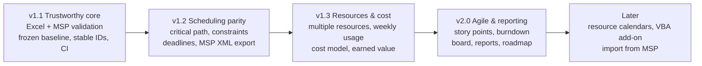

# Backlog

Prioritised from [MSP_GAP_ANALYSIS.md](MSP_GAP_ANALYSIS.md) and the original requirements. Each ID links to its GitHub issue; labels carry priority, size, epic and release.

**Priority:** P0 = needed before relying on it · P1 = core MS Project parity · P2 = valuable · P3 = nice to have
**Size:** S ≈ under a day · M ≈ 1–3 days · L ≈ a week or more
**Approach:** F = formulas in the workbook · Py = Python script in this repo (build and test only) · Web = browser page, no install · VBA = optional macro add-on

## What end users need

| Piece | Who needs it | What they need |
|---|---|---|
| `Project_Planner.xlsx` (formulas) | Everyone | Excel only (desktop, web, iPhone/iPad, Mac). No macros, no Python. |
| Build script and tests (Python) | Developers of this repo | Python + LibreOffice. GitHub Actions runs them, so users never do. |
| MS Project XML converter (B-701/B-702) | Anyone moving to/from MS Project | A web page that runs in the browser, phone included. Nothing to install. Python CLI version for automation. |
| Macro add-on `.xlsm` (B-704) | Optional, desktop Excel users who want buttons | Desktop Excel with macros enabled. Excel for web, iPhone and iPad can't run macros, so no feature may depend on it; each button only automates something the .xlsx can already do by hand. |

## Roadmap

| Release | Goal | Items |
|---|---|---|
| **v1.1 Trustworthy core** | Safe to use on a real project and hand to MS Project users | B-001, B-002, B-003, B-004, B-005, B-008, B-104, B-204, B-802 |
| **v1.2 Scheduling parity** | Behaves like MS Project's scheduler | B-101, B-103, B-105, B-501, B-503, B-701, B-703 |
| **v1.3 Resources & cost** | Real resource planning | B-203, B-301, B-302, B-303, B-304, B-401 |
| **v2.0 Agile & reporting** | Sprint planning and status reporting | B-402, B-403, B-404, B-505, B-601, B-602 |
| **Later** | | everything else |

## Top 10 recommendations

1. **B-001 / B-002** – Prove it in real Excel and MS Project before adding features.
2. **B-003** – Frozen baseline. Without it, "planned vs actual" can silently drift.
3. **B-004** – Stable Unique IDs so inserting a task doesn't break links.
4. **B-105** – Critical path and slack: the most-used MS Project analysis that is missing.
5. **B-701** – Microsoft Project XML export: the real path to "fully compatible".
6. **B-301** – Multiple resources per task.
7. **B-304** – Weekly resource usage counting working days only.
8. **B-203** – Earned value (SPI / CPI), since cost data already exists.
9. **B-403** – Sprint burndown / burnup.
10. **B-501** – Expand / collapse outline.

---

## E0 – Validation and hardening

| ID | Item | Pri | Size | How | Acceptance criteria |
|---|---|---|---|---|---|
| [B-001](https://github.com/LoneWolfDen/excel-project-planner/issues/1) | Validate in desktop Excel (Windows and Mac) and Excel for the web | P0 | S | – | Opens with no repair prompt and no circular-reference warning; dates match the LibreOffice test results; `WORKDAY.INTL` shows no `#NAME?`. Results recorded in `docs/compatibility.md`. |
| [B-002](https://github.com/LoneWolfDen/excel-project-planner/issues/2) | Round-trip test with MS Project | P0 | M | – | Sample project imported via the Import Wizard; IDs, outline, durations, links, resources, actuals and baseline match; differences documented with the import map used. |
| [B-003](https://github.com/LoneWolfDen/excel-project-planner/issues/3) | Frozen baseline | P0 | M | F + VBA later | New input columns Baseline Start / Finish / Duration / Work / Cost. "Set baseline" = documented copy → paste values (one-click in B-704). Variance and status measured against the baseline when present, falling back to the calculated plan. Rename columns to MS Project terms: Baseline, Start/Finish (current schedule), Actual. |
| [B-004](https://github.com/LoneWolfDen/excel-project-planner/issues/4) | Stable Unique ID (UID) for links | P0 | M | F | UID column with prefilled constants; predecessors reference UID; inserting or deleting rows keeps links correct; MSP export uses UID. Test inserts a row and checks dates. |
| [B-005](https://github.com/LoneWolfDen/excel-project-planner/issues/5) | Invalid-link detection | P1 | S | F | Linking to self, own summary or a summary task shows "Invalid link" in a check column and is ignored by scheduling, instead of causing a circular reference. |
| [B-006](https://github.com/LoneWolfDen/excel-project-planner/issues/6) | Excel Tables with structured references | P1 | L | F | Tasks, Resources, Sprints become Excel Tables; formulas read `[@Duration]`; new rows inherit formulas automatically. Spike first: confirm LibreOffice can still recalculate for tests. |
| [B-007](https://github.com/LoneWolfDen/excel-project-planner/issues/7) | Performance at scale | P1 | M | F | Generate 2,000 tasks; edit-to-recalc under 1 s in Excel; replace volatile OFFSET where it doesn't create circularity. |
| [B-008](https://github.com/LoneWolfDen/excel-project-planner/issues/8) | CI on GitHub Actions | P1 | S | Py | Workflow installs LibreOffice, builds the workbook, runs the tests, uploads the .xlsx as an artifact on every push. |
| [B-009](https://github.com/LoneWolfDen/excel-project-planner/issues/9) | Configurable row capacity | P2 | S | Py | Build script options `--tasks`, `--resources`, `--sprints`, `--gantt-columns`. |
| [B-010](https://github.com/LoneWolfDen/excel-project-planner/issues/10) | Locale-safe labels and date formats | P2 | S | F | Weekday and month labels don't depend on the Excel language; date format is a setting. |

## E1 – Scheduling engine

| ID | Item | Pri | Size | How | Acceptance criteria |
|---|---|---|---|---|---|
| [B-101](https://github.com/LoneWolfDen/excel-project-planner/issues/11) | More predecessors per task | P1 | M | F | Four inline predecessor slots, plus optional Links sheet (one row per link) for unlimited links. MSP-format predecessor text includes all. |
| [B-102](https://github.com/LoneWolfDen/excel-project-planner/issues/12) | Lag in % of predecessor duration and elapsed days | P3 | S | F | Lag accepts `50%` and `3ed`. |
| [B-103](https://github.com/LoneWolfDen/excel-project-planner/issues/13) | All MS Project constraint types | P1 | M | F | Constraint Type dropdown (ASAP, ALAP, SNET, SNLT, FNET, FNLT, MSO, MFO) + date; conflict flag when a link can't be honoured; exported to MSP. ALAP depends on B-105. |
| [B-104](https://github.com/LoneWolfDen/excel-project-planner/issues/14) | Deadlines | P1 | S | F | Deadline column; flag and Gantt marker when forecast finish > deadline; exported to MSP Deadline field. |
| [B-105](https://github.com/LoneWolfDen/excel-project-planner/issues/15) | Critical path and slack (backward pass) | P1 | L | F | Late Start, Late Finish, Total Slack, Free Slack, Critical flag; critical bars red on Gantt. Successors must be below predecessors (flagged otherwise) to avoid circular formulas. Tests against a hand-calculated network. |
| [B-106](https://github.com/LoneWolfDen/excel-project-planner/issues/16) | Task types and effort-driven scheduling | P2 | M | F | Task Type (Fixed Duration / Fixed Work / Fixed Units); entering Work derives Duration from units. |
| [B-107](https://github.com/LoneWolfDen/excel-project-planner/issues/17) | Duration units | P3 | M | F | Duration in hours, days, weeks, months; elapsed durations; estimated flag (`?`). |
| [B-108](https://github.com/LoneWolfDen/excel-project-planner/issues/18) | Resource and task calendars | P2 | L | F | Per-resource working week and leave dates; task scheduled on its resource's calendar. Depends on B-303. |
| [B-109](https://github.com/LoneWolfDen/excel-project-planner/issues/19) | Recurring tasks | P3 | M | Py/VBA | Generate a summary with N occurrences (e.g. weekly status meeting). |
| [B-110](https://github.com/LoneWolfDen/excel-project-planner/issues/20) | Inactive and split tasks | P3 | M | F | Active flag excludes a task from schedule and roll-ups; split represented as two segments on the Gantt. |
| [B-111](https://github.com/LoneWolfDen/excel-project-planner/issues/21) | Project summary row and milestone flag | P3 | S | F | Row 0 rolls up the whole project; "Milestone" flag for non-zero-duration tasks. |
| [B-112](https://github.com/LoneWolfDen/excel-project-planner/issues/22) | Resource levelling | P3 | L | Py | Script delays lowest-priority tasks to remove over-allocation and writes a levelling delay column. |

## E2 – Tracking and progress

| ID | Item | Pri | Size | How | Acceptance criteria |
|---|---|---|---|---|---|
| [B-201](https://github.com/LoneWolfDen/excel-project-planner/issues/23) | Multiple baselines and interim plans | P2 | M | F + VBA | Baseline 1–3 columns, selectable "compare against" baseline in Settings. Depends on B-003. |
| [B-202](https://github.com/LoneWolfDen/excel-project-planner/issues/24) | Actual / remaining duration, actual work, % work complete | P2 | M | F | Entering actual work or remaining duration drives % complete and forecast, like MS Project. |
| [B-203](https://github.com/LoneWolfDen/excel-project-planner/issues/25) | Earned value | P1 | M | F | Actual Cost input; PV, EV, AC, SV, CV, SPI, CPI, EAC, VAC per task and project; dashboard tiles with RAG. Depends on B-003. |
| [B-204](https://github.com/LoneWolfDen/excel-project-planner/issues/26) | Full variance set | P1 | S | F | Start, finish, duration, work and cost variance against baseline. |
| [B-205](https://github.com/LoneWolfDen/excel-project-planner/issues/27) | Progress line on Gantt | P3 | M | F | Marker per task showing where progress is vs status date. |
| [B-206](https://github.com/LoneWolfDen/excel-project-planner/issues/28) | MS Project status names | P2 | S | F | Status matches MS Project's Status field (Complete, On Schedule, Late, Future Task) plus the current richer statuses. |
| [B-207](https://github.com/LoneWolfDen/excel-project-planner/issues/29) | Status snapshot history | P2 | M | VBA/Py | "Record snapshot" stores date, forecast finish, % complete, cost to a History sheet for trend charts. |

## E3 – Resources and cost

| ID | Item | Pri | Size | How | Acceptance criteria |
|---|---|---|---|---|---|
| [B-301](https://github.com/LoneWolfDen/excel-project-planner/issues/30) | Multiple resources per task (assignments) | P1 | L | F | Assignments sheet (Task UID, Resource, Units); work and cost per assignment; Tasks shows `A[50%],B`; resource totals and sprint load use assignments; MSP export carries all. |
| [B-302](https://github.com/LoneWolfDen/excel-project-planner/issues/31) | Cost model | P2 | M | F | Overtime rate, cost per use, fixed cost per task; Material = quantity × rate (no hours); Cost resources take an amount. |
| [B-303](https://github.com/LoneWolfDen/excel-project-planner/issues/32) | Resource availability and leave | P2 | M | F | Leave sheet (resource, from, to); part-time max units by date range; capacity excludes leave. |
| [B-304](https://github.com/LoneWolfDen/excel-project-planner/issues/33) | Weekly resource usage | P1 | M | F | Resource × week grid of hours counting working days only, over-allocation in red, resource histogram chart. |
| [B-305](https://github.com/LoneWolfDen/excel-project-planner/issues/34) | Over-allocation flag on tasks | P2 | S | F | Task row flags when its resource is over-allocated in any week of the task. |
| [B-306](https://github.com/LoneWolfDen/excel-project-planner/issues/35) | Role-based (generic) resources | P3 | S | F | Plan by role, then swap in named people; capacity by role. |

## E4 – Agile and sprint planning

| ID | Item | Pri | Size | How | Acceptance criteria |
|---|---|---|---|---|---|
| [B-401](https://github.com/LoneWolfDen/excel-project-planner/issues/36) | Manual sprint assignment and story points | P1 | S | F | Sprint override column (dropdown) wins over the automatic sprint; Story Points column; sprint capacity in points. |
| [B-402](https://github.com/LoneWolfDen/excel-project-planner/issues/37) | Velocity | P2 | S | F | Completed points per sprint, rolling average, forecast sprints remaining. |
| [B-403](https://github.com/LoneWolfDen/excel-project-planner/issues/38) | Burndown and burnup | P1 | M | F | Daily remaining work/points for the active sprint and the release; ideal line; charts on Sprints and Dashboard. |
| [B-404](https://github.com/LoneWolfDen/excel-project-planner/issues/39) | Board view | P2 | M | F | Formula-generated board: columns Not Started / In Progress / Behind / Complete, filterable by sprint and resource. |
| [B-405](https://github.com/LoneWolfDen/excel-project-planner/issues/40) | Product backlog sheet | P2 | M | F | Unscheduled items with priority and points; promoted to Tasks with a sprint. |
| [B-406](https://github.com/LoneWolfDen/excel-project-planner/issues/41) | Flexible sprint calendar | P2 | S | F | Option to type sprint dates and names instead of generating them. |
| [B-407](https://github.com/LoneWolfDen/excel-project-planner/issues/42) | Sprint field in MS Project export | P2 | S | F | Sprint and story points exported to MS Project custom fields (e.g. Text1, Number1); documented. |

## E5 – Views and usability

| ID | Item | Pri | Size | How | Acceptance criteria |
|---|---|---|---|---|---|
| [B-501](https://github.com/LoneWolfDen/excel-project-planner/issues/43) | Expand / collapse outline | P1 | S | Py + F | Rows grouped by outline level on Tasks and Gantt; "Show to level N" setting through a helper filter. |
| [B-502](https://github.com/LoneWolfDen/excel-project-planner/issues/44) | Indented names on Tasks | P2 | S | F | Display column with indentation, or conditional number format, verified in Excel. |
| [B-503](https://github.com/LoneWolfDen/excel-project-planner/issues/45) | Gantt enhancements | P1 | M | F | Critical (B-105) and deadline (B-104) formatting; resource name label after bar; month / quarter scales; colours from a theme table in Settings. |
| [B-504](https://github.com/LoneWolfDen/excel-project-planner/issues/46) | Calendar view | P3 | M | F | Month grid listing tasks active each day. |
| [B-505](https://github.com/LoneWolfDen/excel-project-planner/issues/47) | Roadmap / timeline view | P1 | M | F | One-page view of phases and milestones by month for executives. |
| [B-506](https://github.com/LoneWolfDen/excel-project-planner/issues/48) | Network diagram | P3 | M | Py | Script exports links to Mermaid / Graphviz image. |
| [B-507](https://github.com/LoneWolfDen/excel-project-planner/issues/49) | Saved views and filters | P2 | S | F | Helper columns + slicers (with B-006) for Late, This week, Milestones, By resource. |
| [B-508](https://github.com/LoneWolfDen/excel-project-planner/issues/50) | Print layouts | P2 | S | Py | Gantt and Tasks print on A3 landscape with repeated headers. |
| [B-509](https://github.com/LoneWolfDen/excel-project-planner/issues/51) | Custom fields | P2 | S | F | Text1–5, Number1–5, Flag1–3 columns mapped to MS Project fields on export. |

## E6 – Reports

| ID | Item | Pri | Size | How | Acceptance criteria |
|---|---|---|---|---|---|
| [B-601](https://github.com/LoneWolfDen/excel-project-planner/issues/52) | Standard reports | P1 | M | F | Late tasks, Next 2 weeks, Milestone report, Cost overview, Resource overview. |
| [B-602](https://github.com/LoneWolfDen/excel-project-planner/issues/53) | RAG status | P1 | S | F | Project and phase RAG from schedule and cost variance with thresholds in Settings. |
| [B-603](https://github.com/LoneWolfDen/excel-project-planner/issues/54) | Trend charts | P2 | S | F | Forecast finish and cost trend from snapshots. Depends on B-207. |
| [B-604](https://github.com/LoneWolfDen/excel-project-planner/issues/55) | One-page status report | P2 | M | F | Printable summary: RAG, milestones, top risks/issues, next steps. |
| [B-605](https://github.com/LoneWolfDen/excel-project-planner/issues/56) | RAID log | P2 | M | F | Risks, Assumptions, Issues, Dependencies sheet with owner, due date, linked task UID. |

## E7 – Interoperability and automation

| ID | Item | Pri | Size | How | Acceptance criteria |
|---|---|---|---|---|---|
| [B-701](https://github.com/LoneWolfDen/excel-project-planner/issues/57) | Export to Microsoft Project XML (MSPDI) | P1 | L | Web + Py | `planner export-xml file.xlsx out.xml` writes tasks, outline, links by UID, calendar and holidays, constraints, baselines, resources, assignments; MS Project opens it with matching dates. Delivered as a browser page (drop the .xlsx, download the .xml; works on a phone) and a Python CLI sharing the same field mapping. |
| [B-702](https://github.com/LoneWolfDen/excel-project-planner/issues/58) | Import from MS Project (.xml / .mpp) | P1 | L | Web + Py | `planner import file.mpp` fills a fresh workbook's inputs; round-trips with B-701. |
| [B-703](https://github.com/LoneWolfDen/excel-project-planner/issues/59) | Saved Import Wizard map | P1 | S | – | Documented / saved map so the Excel import takes three clicks; MS Project → Excel export map for the reverse. |
| [B-704](https://github.com/LoneWolfDen/excel-project-planner/issues/60) | Optional macro add-on (.xlsm) | P2 | L | VBA | Buttons: Set Baseline, Insert Task (keeps links), Indent / Outdent, Expand / Collapse, Record Snapshot. The .xlsx stays macro-free and every button has a documented manual equivalent. |
| [B-705](https://github.com/LoneWolfDen/excel-project-planner/issues/61) | Office Scripts for Excel for the web | P3 | M | TS | Same actions as B-704 for Excel online. |
| [B-706](https://github.com/LoneWolfDen/excel-project-planner/issues/62) | CSV export for Jira / Azure DevOps / Planner | P3 | S | F/Py | Export sheet or script producing a CSV that Jira, Azure DevOps and Microsoft Planner can import (summary, description, dates, assignee, parent). |
| [B-707](https://github.com/LoneWolfDen/excel-project-planner/issues/63) | Portfolio roll-up | P3 | L | Py | Combine several planners into one portfolio dashboard; optional link to project_finance_engine costs. |

## E8 – Documentation and packaging

| ID | Item | Pri | Size | How | Acceptance criteria |
|---|---|---|---|---|---|
| [B-801](https://github.com/LoneWolfDen/excel-project-planner/issues/64) | User guide with screenshots | P2 | M | – | Step-by-step guide covering each sheet, plus a short video or GIFs. |
| [B-802](https://github.com/LoneWolfDen/excel-project-planner/issues/65) | Blank template alongside the sample | P1 | S | Py | Build produces `Project_Planner_Blank.xlsx` with no sample data. |
| [B-803](https://github.com/LoneWolfDen/excel-project-planner/issues/66) | Versioning and releases | P2 | S | – | CHANGELOG, version shown on Instructions sheet, GitHub release with the .xlsx attached. |
| [B-804](https://github.com/LoneWolfDen/excel-project-planner/issues/67) | More sample projects | P3 | S | Py | Software, construction, event samples. |
