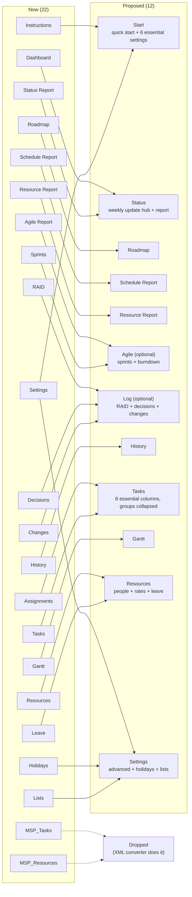

# Simplification review (v1.6)

The planner now matches most of what MS Project does, but it shows all of it at once. This review looks at the
workbook as built at v1.6 (main after #82) through three lenses: the project manager who types the plan, the delivery
manager who reports on it every week, and the architect / full-stack developer who keeps it fast, correct and
upgradable. It ends in the backlog epic **E9 – Simplify** in [BACKLOG.md](BACKLOG.md).

The goal is not to copy MS Project's structure: it is to keep what the engine can do, and ask the user for far less.

## Where we are

**22 sheets**, of which 10 take input:

| Sheet | Typed by the user | Notes |
|---|---|---|
| Settings | 31 inputs | 6 are needed to start (name, manager, start date, status date, working week, hours/day); the rest have good defaults. The working week alone is 7 Yes/No rows. Three separate "scroll" dates (GanttStart, RoadmapStart, ResourceWeekStart). |
| Tasks | **34 input columns**, 36 visible calculated columns, 82 hidden helpers | Predecessors take 12 columns (UID / Type / Lag x 4). Baseline is 5 pasted columns next to 5 source columns. |
| Resources | 8 | Names typed here, then picked again on Leave, Assignments, Tasks and RAID. |
| Assignments | 3 | A second place to put people on a task; the first person is on Tasks. |
| Leave | 1 + 36 month columns | One row per person: the name is entered a second time. |
| Holidays | 2 | A small table on its own sheet. |
| Sprints | 2 (Goal, Points Capacity) | Mostly output, overlapping the Agile Report and Resource Report. |
| RAID / Decisions / Changes | 12 / 8 / 11 | Three logs with the same shape (Ref, date, owner, status, task UID). |
| Status Report | PM RAG and comments | Weekly inputs sit on a report sheet, away from the status date (Settings). |
| History | paste a row | Copy / paste values each reporting date (no macros). |
| Lists | 11 dropdown tables | Rarely changed; shown as a tab. |

**Output-only:** Instructions, Dashboard, Roadmap, Status / Schedule / Resource / Agile Report, Gantt, MSP_Tasks,
MSP_Resources. MSP_Tasks and MSP_Resources (5,550 formulas, 12% of the workbook) only feed MS Project's Import
Wizard, which the MS Project XML converter (export.html) now does better: calendar, holidays, constraints, every link
and assignment.

## Findings

### Project manager (first-time and daily user)

1. **The Tasks sheet is a wall.** 70 visible columns. A first plan needs 6: Level, Task Name, Duration, Predecessors,
   Resource, % Complete. Everything else (mode, constraints, deadline, actuals, actual cost, sprint, story points,
   baseline, variances, slack, earned value) is valuable later but in the way on day one.
2. **Predecessors are 12 columns.** MS Project users type `3, 5SS+2d` in one cell. Here the same link is three cells,
   and a fourth predecessor means scrolling sideways.
3. **People are entered in four places.** Resources (name), Leave (name again), Tasks (Resource + Units) and
   Assignments (Task UID + Resource + Units for the second person). MS Project has one Resource Names cell:
   `Alex[50%], Jordan`.
4. **Two kinds of check column.** Link Check, Deadline Check, Over-allocated and the UID highlight each live in a
   different place; a new user doesn't know which to look at.
5. **% Complete is a guess, not a standard.** Two people mean different things by "60%", so earned value and
   status rest on opinion. A **Stage** dropdown (Not Started, Design, In Development, Test Ready, In Testing,
   Complete) is clearer: each stage carries a fixed % from a table on Settings (the "weighted milestone" method of
   earned value), so the same stage always means the same progress. Stage names and weights are editable for
   non-software work (e.g. Planning, Build, Review). Actual Start and Actual Finish stay as real dates the PM types;
   Issues asks for them when a task leaves Not Started or reaches Complete, so dates and stage can't disagree.
   % Complete stays as an optional override for anyone who prefers it.
6. **No guidance at the point of entry.** Header comments exist, but nothing tells a user which columns are required.
   Excel's data-validation input message (shown when the cell is selected) works everywhere, including Excel for the
   web and iPhone.

### Delivery manager (weekly reporting and governance)

1. **The weekly update touches six sheets:** Settings (status date), Tasks (progress), RAID, Changes, Status Report
   (PM RAG and comments) and History (snapshot). It should be three: Tasks, Log, Status.
2. **Dashboard and Status Report overlap.** Both show finish, slip, RAG, SPI / CPI and next milestones. One status
   page, printed on one sheet, is what a steering committee reads.
3. **RAID, Decisions and Changes are one log in practice** ("RAIDD" plus change control). Three sheets mean three
   filters, three owner columns and three places to look before a meeting. One Log with a Type column (Risk,
   Assumption, Issue, Dependency, Decision, Change) keeps type-specific columns (probability and impact; schedule
   and cost impact) and their totals.
4. **Agile is a module, not the default.** Sprints, the Agile Report, Story Points and Planned Sprint matter to agile
   teams only; for a waterfall plan they are four places of noise.
5. **Names should say what people expect.** "Forecast Start" on Tasks, "Start" on the Roadmap and "Planned" meaning
   "baseline, or calculated before a baseline" confuse readers. Plain names: Start / Finish (the current schedule),
   Baseline Start / Finish (the commitment).

### Architect / full-stack developer

1. **Sheet count is cost.** Every sheet is a tab to explain, test and keep in sync. 22 can become 12 with no loss of
   function (map below).
2. **One source of truth per fact.** A person's name, rate, capacity and leave belong on one row. Typing the name
   again on Leave invites mismatches the formulas then have to catch.
3. **Text inputs parsed by formulas are proven here.** Leave already parses `16, 17(0.5)` in Excel 2019-compatible
   formulas (no LET / TEXTSPLIT). The same technique turns a Predecessors cell (`12, 14SS+2d`) and a Resource Names
   cell (`AC, JL[50%]`) into the hidden per-link / per-person helper columns the engine already uses, so the
   scheduling, critical path, export and reports don't change. The parse reads inputs only, so it isn't volatile.
4. **Links must stay on UID.** Excel can't rewrite typed text when rows move, so a typed predecessor must refer to
   the UID, not the row ID (MS Project rewrites ID text itself; we can't). The by-ID text stays a calculated column
   for MS Project users.
5. **Hide, don't delete.** Excel column groups (the + / - buttons) collapse optional columns without removing them;
   the engine keeps working and nothing is lost when a user expands a group. This is the cheapest big win.
6. **Upgrades need a path.** Users already have data in v1.4–v1.6 workbooks and every structural change renames or
   moves inputs. The converter page can read an old workbook's inputs by header (as the MS Project import already
   does) and build the new template from them. This must ship before, or with, the first breaking change.
7. **Modules keep the default small.** A build option (and two prebuilt downloads: Simple, Full) can leave out Agile,
   Log and Earned Value for teams that don't use them, which also cuts formulas and recalculation.

## Target: 22 sheets → 12

| Sheet now | Becomes | Why |
|---|---|---|
| Instructions + Settings (essential six) | **Start** | One place to begin: what to type, in order, and the six settings a plan needs. |
| Settings (the rest) + Holidays + Lists | **Settings** | Advanced settings, the holiday table and the dropdown lists together, after the main sheets. |
| Dashboard + Status Report | **Status** | One status page; the weekly inputs (status date, PM RAG, comments, snapshot row) live here. |
| RAID + Decisions + Changes | **Log** (optional module) | One log with a Type column and type-specific columns. |
| Sprints + Agile Report | **Agile** (optional module) | Sprint calendar inputs and the agile charts on one sheet. |
| Resources + Leave | **Resources** | One row per person: details, rate, capacity, leave months. |
| Tasks + Assignments | **Tasks** | Resource Names text column replaces Resource, Units and the Assignments sheet. |
| MSP_Tasks, MSP_Resources | dropped | Read-only copies for MS Project's Import Wizard; the XML converter replaces them (decision 4). |
| Roadmap, Schedule Report, Resource Report, History, Gantt | unchanged | |

## Tasks: what a first-time user sees

Default view after E9 (optional groups collapsed with Excel's column + / - buttons; every column still exists):

| Group | Columns | Shown by default |
|---|---|---|
| Essential inputs | UID (pre-filled), Level, Task Name, Duration, **Predecessors** (`12, 14SS+2d`), **Resources** (`AC, JL[50%]`), **Stage**, Actual Start, Actual Finish, Notes | ✅ |
| Key results | ID, WBS, Start, Finish, Status, Critical, **Issues** (one plain-language column for every problem on the row) | ✅ |
| Scheduling | Mode, Constraint, Constraint Date, Deadline | collapsed |
| Tracking | % Complete override, Actual Cost | collapsed |
| Agile | Planned Sprint, Story Points, Sprint | collapsed (or not built without the Agile module) |
| Analysis | Baseline / variance, late dates and slack, work and cost, earned value | collapsed |
| Baseline | 5 source + 5 baseline columns | collapsed; "Set baseline" steps on Start |

**Inputs to start a plan: 34 columns → 9 or 10. Predecessor columns: 12 → 1. Places a person is entered: 4 → 2
(Resources, and the Resources cell of a task).**

## Weekly update, before and after

| Step | Now | Proposed |
|---|---|---|
| Move the status date | Settings | Status |
| Update progress | Tasks: % complete (free entry), actual start, actual finish | Tasks: Stage dropdown, actual start / finish (Issues prompts for missing dates) |
| Update risks, issues, decisions, changes | RAID, Decisions, Changes | Log |
| RAG and comments | Status Report | Status |
| Record the snapshot | History (copy SnapshotNow, paste values) | Status (row to copy) → History |
| Sheets touched | 6 | 3 |

## Decisions for the owner

These change the shape of the workbook; the backlog items assume the recommended option.

1. **Predecessors as one text cell (by UID)** instead of 12 columns. *Recommended.* Typos are reported in Issues;
   the hidden per-link columns stay, so nothing downstream changes.
2. **Resources as one text cell** (names or initials, `[50%]` for units, up to 4 people) instead of Resource, Units
   and the Assignments sheet. *Recommended*, subject to the performance spike in B-906 (per-resource totals sum
   one column per slot).
3. **One Log** for RAID, decisions and changes. *Recommended.* Alternative: merge decisions into RAID and keep
   Changes separate (change control is often owned by a different person).
4. **Drop MSP_Tasks / MSP_Resources.** Nobody types into these two sheets: they are formula copies of Tasks and
   Resources with MS Project's column names, made for the Import Wizard (in MS Project: File > Open the .xlsx, then
   map its columns). Since v1.4 the converter page (`docs/export.html`) writes a Microsoft Project XML file instead,
   which MS Project opens directly with more in it: calendar, holidays, constraints, every link, every assignment and
   the baseline. So the two sheets duplicate the export, cost 5,550 formulas (12% of the workbook) and two tabs.
   *Recommended: remove them.* A build option (`--import-wizard-sheets`) can add them back for anyone whose
   organisation only allows the Import Wizard; no user of the downloaded workbook needs to do anything.
5. **Two downloads, Simple and Full**, rather than one workbook with everything. *Recommended* once modules exist
   (B-913); until then, collapsed groups give most of the benefit.

## Constraints that still apply

Excel alone (desktop, web, iPhone) and Excel 2019 functions; no macros required; structured references only; every
change measured with `scripts/perf_check.py`. Text parsing must stay under Excel's 8,192-character formula limit and
avoid array formulas that Excel 2019 would need Ctrl+Shift+Enter for (the Leave parser shows how).
